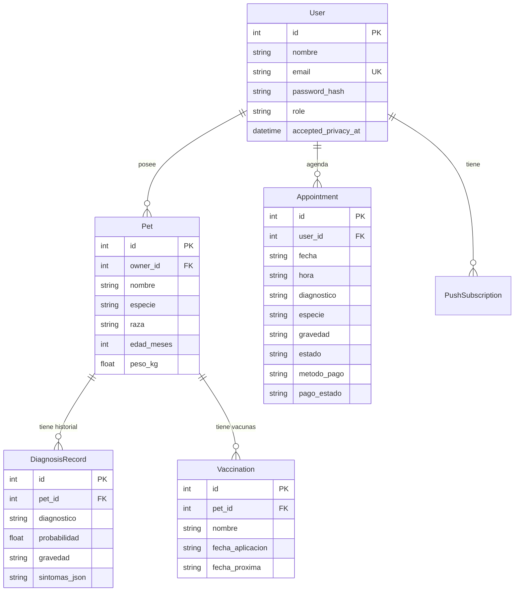
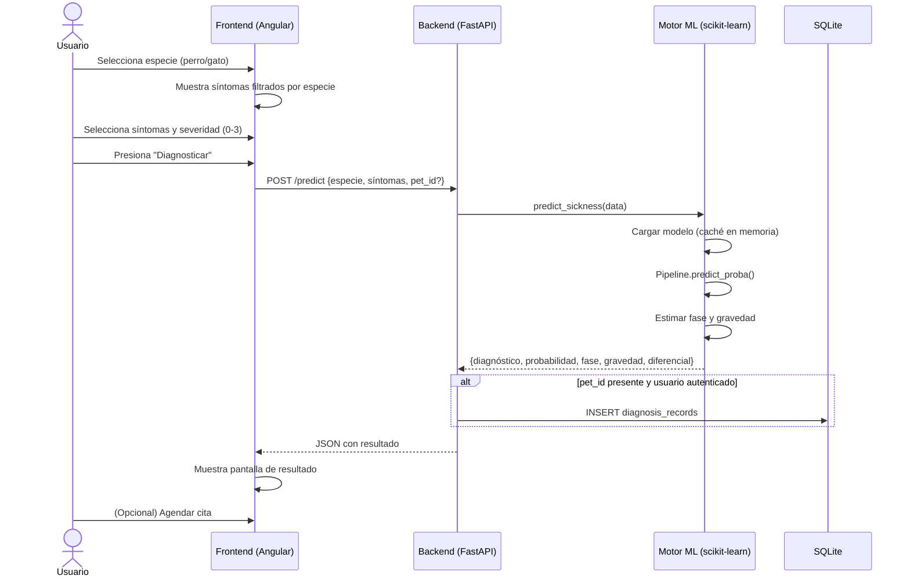
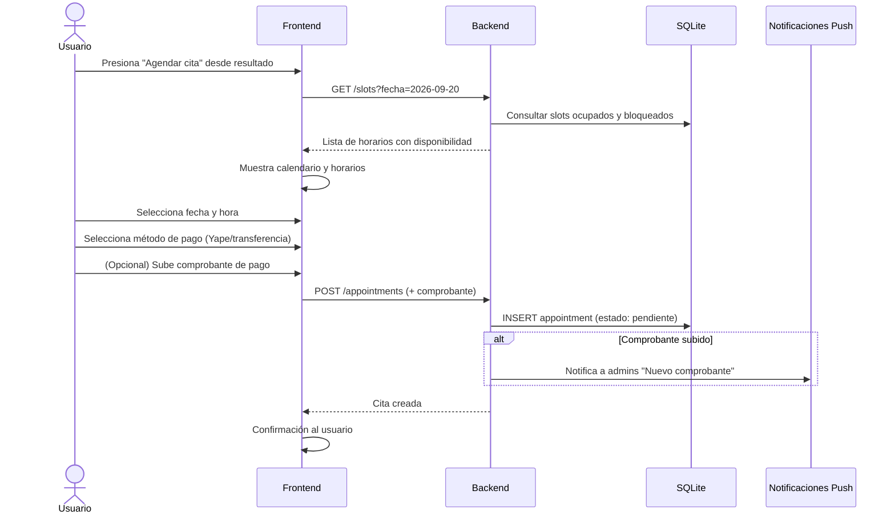
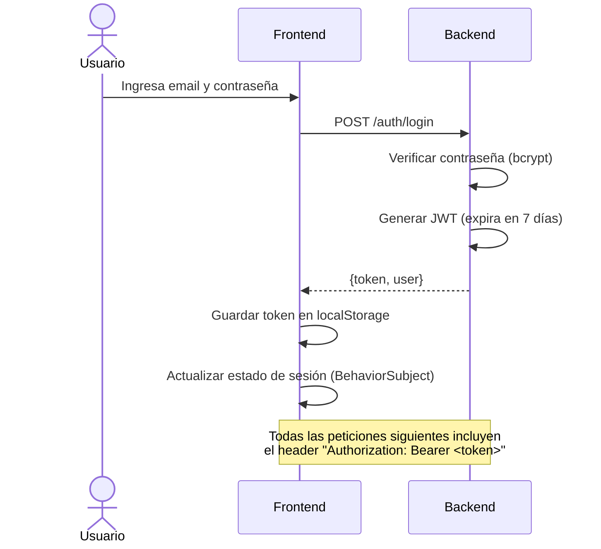

# 🐾 Explicación Completa del Sistema CityVet

> Documento de referencia para sustentar y explicar el proyecto de tesis.
> Cubre: qué es, cómo funciona, qué tecnologías usa, cómo está organizado internamente, cómo se entrenó el modelo de IA, y cómo interactúan todos los componentes.

---

## 1. ¿Qué es CityVet?

**CityVet** es una **aplicación web mobile-first** que permite a los dueños de mascotas (perros y gatos) realizar un **pre-diagnóstico inteligente de enfermedades** a partir de los síntomas que observan en su mascota. Utiliza un modelo de **Machine Learning (regresión logística)** para predecir la enfermedad más probable, estimar la gravedad y facilitar el agendamiento de una cita con el veterinario.

### Problema que resuelve
- Los dueños de mascotas muchas veces no saben si los síntomas que observan son graves o no.
- Ir al veterinario sin información previa retrasa el proceso de diagnóstico.
- El veterinario no tiene contexto previo del caso antes de la consulta.

### Solución
- El usuario selecciona los síntomas que observa → el sistema predice la enfermedad más probable.
- El resultado incluye: enfermedad, porcentaje de confianza, fase estimada y nivel de gravedad.
- Si lo desea, puede agendar una cita directamente, y el diagnóstico se asocia automáticamente a la reserva para que el veterinario ya lo tenga antes de la consulta.

---

## 2. Arquitectura General del Sistema

El sistema sigue una **arquitectura cliente-servidor con API REST**:

```
┌─────────────────────────────────────────────┐
│         CLIENTE (Navegador / Móvil)          │
│         Angular 21 + Ionic 8                 │
│         http://localhost:4200                │
└──────────────────┬──────────────────────────┘
                   │ HTTP/REST (JSON)
                   │ CORS habilitado
┌──────────────────▼──────────────────────────┐
│         SERVIDOR (Backend API)               │
│         FastAPI (Python 3.10+)               │
│         http://localhost:8000                │
└──────┬──────────────────────┬───────────────┘
       │                      │
┌──────▼──────┐       ┌──────▼────────────────┐
│   SQLite    │       │   Modelos ML (Joblib)  │
│ veterinary  │       │   model_perro.pkl      │
│    .db      │       │   model_gato.pkl       │
└─────────────┘       └───────────────────────┘
```

### Componentes principales

| Componente | Tecnología | Responsabilidad |
|---|---|---|
| **Frontend** | Angular 21 + Ionic 8 | Interfaz de usuario, navegación, formularios, visualización de resultados |
| **Backend** | FastAPI (Python) | API REST, lógica de negocio, autenticación, predicción ML |
| **Base de datos** | SQLite + SQLAlchemy | Persistencia de usuarios, citas, mascotas, vacunas, diagnósticos |
| **Motor de ML** | scikit-learn | Predicción de enfermedades a partir de síntomas |

---

## 3. Stack Tecnológico Detallado

### 3.1 Backend (Python)

| Tecnología | Versión | Propósito |
|---|---|---|
| **Python** | 3.10+ | Lenguaje del servidor |
| **FastAPI** | 0.135.3 | Framework de API REST asíncrono, con validación automática y documentación Swagger |
| **Uvicorn** | 0.42.0 | Servidor ASGI de alto rendimiento |
| **SQLAlchemy** | 2.0.41 | ORM (Object-Relational Mapping) para interactuar con la base de datos |
| **SQLite** | 3 | Base de datos relacional embebida (sin necesidad de servidor de BD) |
| **scikit-learn** | 1.8.0 | Entrenamiento y ejecución del modelo de clasificación |
| **pandas** | 3.0.2 | Procesamiento y manipulación del dataset |
| **numpy** | 2.4.4 | Operaciones numéricas y vectoriales |
| **joblib** | 1.5.3 | Serialización de los modelos entrenados (guardar/cargar .pkl) |
| **python-jose** | 3.5.0 | Creación y validación de tokens JWT |
| **passlib + bcrypt** | 1.7.4 / 4.3.0 | Hash seguro de contraseñas (nunca se guarda la contraseña en texto plano) |
| **Pydantic** | 2.12.5 | Validación de datos de entrada (schemas) |
| **slowapi** | 0.1.10 | Rate limiting para proteger contra ataques de fuerza bruta |
| **APScheduler** | 3.11.3 | Tareas programadas (recordatorios de citas) |
| **pywebpush** | 2.3.0 | Notificaciones push (Web Push / VAPID) |

### 3.2 Frontend (TypeScript)

| Tecnología | Versión | Propósito |
|---|---|---|
| **Angular** | 21.2 | Framework SPA (Single Page Application) con componentes standalone, signals, `inject()`, control flow `@if`/`@for` |
| **Ionic** | 8.8 | Componentes UI mobile-first (botones, cards, modales, tabs) |
| **TypeScript** | 5.9.3 | Lenguaje tipado del cliente |
| **RxJS** | 7.8.0 | Programación reactiva (Observable, BehaviorSubject) |
| **FontAwesome** | 7.2.0 | Iconografía complementaria |
| **Angular Material** | 21.2.14 | Componentes adicionales de UI (datepicker) |

### 3.3 ¿Por qué estas tecnologías?

- **FastAPI** se eligió por su velocidad, validación automática con Pydantic, y documentación interactiva (Swagger) generada automáticamente.
- **Angular + Ionic** permite crear una app web que se ve y se comporta como una app nativa móvil, con un solo codebase.
- **SQLite** es ideal para un proyecto de tesis porque no requiere instalar un servidor de base de datos — el archivo `.db` se crea automáticamente.
- **scikit-learn** es la librería estándar de ML en Python, madura y bien documentada.

---

## 4. Modelo de Machine Learning — Explicación Detallada

### 4.1 ¿Qué tipo de modelo es?

El modelo es una **regresión logística multiclase**, que es un algoritmo de clasificación supervisada. Predice a cuál de varias categorías (enfermedades) pertenece un caso, dado un conjunto de entradas (síntomas).

### 4.2 ¿Por qué regresión logística y no otro algoritmo?

Se evaluaron múltiples algoritmos mediante **validación cruzada estratificada repetida (5 folds × 10 repeticiones)**:

| Algoritmo | Evaluado |
|---|---|
| Regresión Logística | ✅ **Seleccionado** |
| Random Forest | ❌ Sobreajuste con pocas muestras |
| Extra Trees | ❌ Similar problema a RF |
| Gradient Boosting | ❌ Sin ventaja sobre LR |
| SVM | ❌ Sin ventaja sobre LR |
| KNN | ❌ Sensible a la escala |

**Resultado**: La regresión logística regularizada fue consistentemente superior en este dataset pequeño (310 muestras). Los modelos de ensemble (Random Forest, etc.) tienden a sobreajustar cuando hay pocas muestras por clase.

### 4.3 El Dataset

- **Ubicación**: [dataset.csv](file:///c:/Users/jesus/tesis_pets/backend/data/dataset.csv)
- **Tamaño**: 310 registros (filas) × 56 columnas
- **Composición**: 1 columna `especie` + 54 columnas de síntomas + 1 columna `enfermedad` (variable objetivo)
- **Escala de síntomas**: 0 = ausente, 1 = leve, 2 = moderado, 3 = grave
- **Tipo**: **Sintético** (generado por código, no de historias clínicas reales)
- **Fuentes clínicas**: Las asociaciones síntoma-enfermedad se tomaron de:
  - Manual Merck/MSD de Veterinaria (referencia internacional estándar)
  - Estudios peruanos publicados (UPCH, SciELO Perú) que documentan la prevalencia de enfermedades en clínicas de Lima

> [!IMPORTANT]
> **Es correcto comunicar en la tesis**: "Dataset sintético con distribución de síntomas informada por literatura veterinaria citada, no por registros clínicos reales." Esto es metodológicamente válido.

### 4.4 Pipeline de entrenamiento

El script de entrenamiento está en [train.py](file:///c:/Users/jesus/tesis_pets/backend/ml/train.py) y sigue estos pasos:

```
Dataset CSV (310 filas)
     │
     ▼
Codificar especie y enfermedad con LabelEncoder
     │
     ▼
Separar por especie (un modelo por especie)
     │
     ▼
Para cada especie:
  ├── Pipeline: StandardScaler → LogisticRegression
  ├── GridSearchCV con validación cruzada (5 folds × 10 repeticiones)
  │   └── Busca mejor C y class_weight
  ├── Evaluar con cross_val_predict (reporte de clasificación + matriz de confusión)
  └── Entrenar modelo final con 100% de los datos
     │
     ▼
Guardar modelos como .pkl (Joblib)
```

**Hiperparámetros buscados**:
- `C` (regularización): [0.1, 0.3, 1.0, 3.0, 10.0, 30.0]
- `class_weight`: [None, "balanced"]

### 4.5 Métricas del modelo

| Especie | Accuracy (CV) | Método de evaluación |
|---|---|---|
| **Perro** | ~98% | Validación cruzada 5×10 folds |
| **Gato** | ~97% | Validación cruzada 5×10 folds |

> [!NOTE]
> Se usa **validación cruzada** (no accuracy de entrenamiento) como métrica, lo cual es estadísticamente correcto. Un único split 80/20 con este tamaño de dataset es demasiado ruidoso.

### 4.6 Pipeline de predicción (en producción)

El motor de predicción está en [predict.py](file:///c:/Users/jesus/tesis_pets/backend/ml/predict.py):

```
Síntomas del usuario (vector de 54 dimensiones, valores 0-3)
     │
     ▼
Se carga el modelo según la especie (cacheado en memoria)
     │
     ▼
Pipeline.predict_proba() → probabilidad REAL (sin distorsión artificial)
     │
     ▼
¿El 2.º diagnóstico está a <15% del principal?
  Sí → Se agrega como diagnóstico diferencial
  (¿El 3.º también? → Se agrega también)
     │
     ▼
Estimación de fase (1-10):
  Busca la muestra más similar en el dataset
  fase = max_severidad × (10/3)
     │
     ▼
Clasificación de gravedad:
  fase 1-3 → leve
  fase 4-6 → moderada (corregido en el código: 4-7)
  fase 7-10 → grave (corregido en el código: 8-10)
     │
     ▼
Respuesta JSON con: diagnóstico, probabilidad, fase, gravedad,
  diagnóstico alternativo (si aplica)
```

### 4.7 Diagnóstico diferencial

Una innovación del sistema: cuando la **segunda enfermedad más probable** está a menos de 15 puntos porcentuales de la primera, se muestra como **diagnóstico diferencial a confirmar por el veterinario**, en lugar de ocultar la incertidumbre con una confianza falsa.

Ejemplo real: **Leucemia Felina (FeLV) vs. Inmunodeficiencia Felina (FIV)** — ambas tienen síntomas casi idénticos y en la práctica real se distinguen por análisis de sangre, no por síntomas.

---

## 5. Arquitectura del Backend — Patrón por Capas

El backend sigue un patrón **Routes → Services → Repositories → Models**, separando responsabilidades:

```
Petición HTTP
     │
     ▼
┌─────────────┐
│   Routes    │  ← Reciben la petición, validan con schemas, llaman al servicio
│  (routes/)  │     admin.py, auth.py, predict.py, appointments.py, etc.
└──────┬──────┘
       │
┌──────▼──────┐
│  Services   │  ← Lógica de negocio (validaciones, reglas, cálculos)
│ (services/) │     auth_service.py, appointment_service.py, diagnosis_service.py
└──────┬──────┘
       │
┌──────▼──────────┐
│  Repositories   │  ← Acceso a datos (queries SQL via SQLAlchemy)
│ (repositories/) │     user_repository.py, appointment_repository.py, etc.
└──────┬──────────┘
       │
┌──────▼──────┐
│   Models    │  ← Definición de tablas de la BD (SQLAlchemy ORM)
│  (models/)  │     User, Appointment, Pet, Vaccination, DiagnosisRecord, etc.
└──────┬──────┘
       │
┌──────▼──────┐
│   Schemas   │  ← Validación de datos de entrada (Pydantic)
│  (schemas/) │     Sintomas, RegisterBody, AppointmentBody, etc.
└─────────────┘
```

### 5.1 Modelos de Base de Datos

| Tabla | Archivo | Descripción |
|---|---|---|
| `users` | [user.py](file:///c:/Users/jesus/tesis_pets/backend/models/user.py) | Usuarios con id, nombre, email, password_hash, role (user/admin), consentimiento de privacidad |
| `appointments` | [appointment.py](file:///c:/Users/jesus/tesis_pets/backend/models/appointment.py) | Citas con diagnóstico asociado, estado (pendiente/confirmada/cancelada), pago |
| `pets` | [pet.py](file:///c:/Users/jesus/tesis_pets/backend/models/pet.py) | Mascotas registradas (nombre, especie, raza, edad, peso) |
| `diagnosis_records` | [diagnosis.py](file:///c:/Users/jesus/tesis_pets/backend/models/diagnosis.py) | Historial de diagnósticos por mascota |
| `vaccinations` | [vaccination.py](file:///c:/Users/jesus/tesis_pets/backend/models/vaccination.py) | Registro de vacunas aplicadas con fecha de próxima dosis |
| `unavailable_slots` | [slot.py](file:///c:/Users/jesus/tesis_pets/backend/models/slot.py) | Horarios bloqueados por el veterinario |
| `payment_config` | [payment_config.py](file:///c:/Users/jesus/tesis_pets/backend/models/payment_config.py) | Configuración de pagos (Yape, transferencia) |
| `push_subscriptions` | [push_subscription.py](file:///c:/Users/jesus/tesis_pets/backend/models/push_subscription.py) | Suscripciones de notificaciones push |

### 5.2 Diagrama Entidad-Relación



---

## 6. Endpoints de la API REST

### 6.1 Predicción (el endpoint principal)

| Método | Ruta | Descripción | Autenticación |
|---|---|---|---|
| `POST` | `/predict` | Predice enfermedad a partir de síntomas | Opcional (sin sesión = diagnóstico anónimo) |

**Entrada** (JSON con 54 síntomas + especie):
```json
{
  "especie": "perro",
  "pet_id": 5,          // opcional: si se incluye, guarda en historial
  "fiebre": 2,
  "tos": 1,
  "vomitos": 3,
  "letargo": 2,
  // ... (todos los síntomas con valor 0-3)
}
```

**Salida**:
```json
{
  "especie": "perro",
  "diagnostico": "Parvovirus",
  "probabilidad": 0.94,
  "fase": 7,
  "gravedad": "grave",
  "diagnostico_alternativo": null,
  "probabilidad_alternativa": null
}
```

### 6.2 Autenticación

| Método | Ruta | Descripción |
|---|---|---|
| `POST` | `/auth/register` | Registro con nombre, email, contraseña (+ código admin opcional) |
| `POST` | `/auth/login` | Login → devuelve token JWT (expira en 7 días) |
| `GET` | `/auth/me` | Datos del usuario actual |
| `PUT` | `/auth/change-password` | Cambiar contraseña |
| `GET` | `/auth/me/export` | Exportar todos mis datos (Ley N.° 29733) |
| `DELETE` | `/auth/me` | Eliminar mi cuenta y todos mis datos |

### 6.3 Citas

| Método | Ruta | Descripción |
|---|---|---|
| `GET` | `/slots?fecha=YYYY-MM-DD` | Horarios disponibles para una fecha |
| `POST` | `/appointments` | Crear cita (requiere sesión) |
| `POST` | `/appointments/with-comprobante` | Crear cita + subir comprobante de pago |
| `GET` | `/appointments/mine` | Mis citas |
| `POST` | `/appointments/{id}/comprobante` | Subir comprobante para una cita existente |

### 6.4 Administración (solo rol admin)

| Método | Ruta | Descripción |
|---|---|---|
| `GET` | `/admin/slots?fecha=` | Todos los horarios con detalle de quién reservó |
| `POST` | `/admin/block` | Bloquear un horario |
| `DELETE` | `/admin/block/{fecha}/{hora}` | Desbloquear horario |
| `GET` | `/admin/appointments` | Todas las citas (con filtro por fecha) |
| `PUT` | `/admin/appointments/{id}/estado` | Actualizar estado de cita |
| `GET` | `/admin/appointments/pending-payments` | Citas con pago pendiente de revisión |
| `PUT` | `/admin/appointments/{id}/pago` | Aprobar o rechazar pago |

### 6.5 Mascotas, Vacunas, Notificaciones y Pagos

| Área | Endpoints |
|---|---|
| **Mascotas** | CRUD completo: crear, listar, actualizar, eliminar. Historial de diagnósticos por mascota |
| **Vacunas** | Registrar vacuna, listar vacunas de una mascota, con cálculo automático de próxima dosis |
| **Push** | Suscribirse a notificaciones, obtener clave VAPID pública |
| **Pagos** | Configuración de datos de pago (Yape/transferencia), editable por el admin |

---

## 7. Arquitectura del Frontend

### 7.1 Organización de carpetas

El frontend sigue una organización por responsabilidad con **alias de import** (`@core/*`, `@shared/*`, `@layout/*`, `@pages/*`):

```
frontend/src/app/
├── core/                    ← Lógica compartida por toda la app
│   ├── services/            ← Servicios singleton (auth, prediction, appointment, etc.)
│   ├── guards/              ← Guards de ruta (authGuard, adminGuard)
│   ├── models/              ← Modelos de datos (symptom, disease-info, pet)
│   ├── constants/           ← Constantes
│   └── interceptors/        ← HTTP interceptor (adjunta JWT a todas las peticiones)
│
├── shared/                  ← Componentes reutilizables sin lógica de negocio
│   └── components/          ← header, footer, paginación
│
├── layout/                  ← Shell de la aplicación
│   ├── app-shell/           ← Sidebar para escritorio
│   ├── tabs/                ← Navegación por pestañas (móvil)
│   └── tab1/, tab2/, tab3/  ← Contenido de cada tab
│
└── pages/                   ← Páginas de features (una carpeta por pantalla)
    ├── home/                ← Tab 1: Bienvenida
    ├── pet-selection/       ← Tab 2: Selección de especie (perro/gato)
    ├── health-info/         ← Tab 3: Base de conocimiento de enfermedades
    ├── symptoms-selection/  ← Selector de síntomas con categorías y severidad
    ├── diagnostic-result/   ← Resultado del diagnóstico
    ├── schedule/            ← Calendario de citas
    ├── payment/             ← Métodos de pago
    ├── admin/               ← Panel administrativo
    ├── login/               ← Inicio de sesión
    ├── register/            ← Registro
    ├── profile/             ← Perfil del usuario
    ├── privacy-policy/      ← Política de privacidad
    └── my-data-export/      ← Exportación de datos personales
```

### 7.2 Características modernas de Angular usadas

| Característica | Descripción |
|---|---|
| **Standalone components** | Sin `NgModule`, cada componente es independiente |
| **`inject()`** | Inyección de dependencias funcional (no en constructores) |
| **`@if` / `@for`** | Control flow nativo del template (reemplaza `*ngIf` / `*ngFor`) |
| **Signals** | Reactividad moderna |
| **Lazy loading** | Cada página se carga solo cuando se navega a ella |
| **`bootstrapApplication`** | Bootstrap sin módulo raíz |

### 7.3 Servicios principales del frontend

| Servicio | Archivo | Responsabilidad |
|---|---|---|
| **AuthService** | [auth.ts](file:///c:/Users/jesus/tesis_pets/frontend/src/app/core/services/auth.ts) | Login, registro, logout, gestión de sesión JWT, exportar/eliminar datos |
| **PredictionService** | [prediction.ts](file:///c:/Users/jesus/tesis_pets/frontend/src/app/core/services/prediction.ts) | Envía síntomas al backend y recibe el diagnóstico |
| **AppointmentService** | [appointment.ts](file:///c:/Users/jesus/tesis_pets/frontend/src/app/core/services/appointment.ts) | CRUD de citas, slots, administración |
| **PetService** | [pet.ts](file:///c:/Users/jesus/tesis_pets/frontend/src/app/core/services/pet.ts) | CRUD de mascotas |
| **ThemeService** | [theme.ts](file:///c:/Users/jesus/tesis_pets/frontend/src/app/core/services/theme.ts) | Toggle de tema oscuro/claro |
| **PushNotificationService** | [push-notification.ts](file:///c:/Users/jesus/tesis_pets/frontend/src/app/core/services/push-notification.ts) | Suscripción a notificaciones push |

### 7.4 Guards de ruta

| Guard | Función |
|---|---|
| `authGuard` | Si el usuario no está autenticado → redirige a `/login` |
| `adminGuard` | Si el usuario no es admin → redirige a `/tabs/tab1` |

---

## 8. Flujos Principales del Sistema

### 8.1 Flujo de Diagnóstico (el flujo principal)



### 8.2 Flujo de Agendamiento de Cita



### 8.3 Flujo de Autenticación



---

## 9. Seguridad del Sistema

| Mecanismo | Descripción |
|---|---|
| **JWT (JSON Web Token)** | Autenticación stateless. El token se genera al login, expira en 7 días, se envía en cada petición |
| **bcrypt** | Las contraseñas se hashean con bcrypt antes de guardarlas. Nunca se almacena la contraseña en texto plano |
| **Rate Limiting** | Los endpoints `/auth/*` están protegidos con slowapi para evitar ataques de fuerza bruta |
| **CORS** | Configurado para aceptar solo los orígenes permitidos (en producción) |
| **Guards de ruta** | El frontend impide la navegación a rutas protegidas |
| **Verificación de propiedad** | Cada petición verifica que el usuario sea dueño del recurso (ej: "esta mascota no te pertenece") |
| **SECRET_KEY dinámica** | Sin `.env`, la clave se genera aleatoriamente en cada arranque (no queda embebida en el código fuente) |

---

## 10. Funcionalidades Adicionales

### 10.1 Notificaciones Push (Web Push / VAPID)
- Estándar abierto RFC 8292, sin dependencia de Firebase
- El admin recibe notificación cuando un usuario sube un comprobante de pago
- El usuario recibe notificación cuando su pago es aprobado/rechazado
- Se envían recordatorios automáticos de cita (día anterior)

### 10.2 Recordatorios automáticos
- Un job programado con APScheduler revisa cada 30 minutos las citas confirmadas del día siguiente
- Envía un push al usuario una sola vez por cita (flag `recordatorio_enviado`)

### 10.3 Gestión de mascotas y historial
- Los usuarios pueden registrar sus mascotas (nombre, especie, raza, edad, peso)
- Cada diagnóstico puede guardarse en el historial de la mascota
- Se puede ver el historial completo de diagnósticos por mascota

### 10.4 Vacunas
- Registro de vacunas aplicadas
- Cálculo automático de la próxima dosis basado en el esquema de SENASA
- Esquema diferenciado para perros (múltiple + rabia) y gatos (triple felina + rabia)

### 10.5 Pagos
- Soporte para Yape (número + QR) y transferencia bancaria
- El admin puede configurar sus datos de pago desde el panel
- El usuario sube comprobante → el admin lo aprueba o rechaza
- Notificaciones push en ambas direcciones

### 10.6 Cumplimiento de privacidad
- **Consentimiento registrado**: se guarda `accepted_privacy_at` en la BD
- **Exportación de datos**: endpoint `GET /auth/me/export` permite al usuario descargar todos sus datos
- **Eliminación de cuenta**: endpoint `DELETE /auth/me` borra todo (mascotas, vacunas, diagnósticos, citas, suscripciones push)
- Inspirado en la **Ley N.° 29733** (Ley de Protección de Datos Personales del Perú)

---

## 11. Pruebas Automatizadas

El proyecto incluye **13 archivos de test** en [tests/](file:///c:/Users/jesus/tesis_pets/backend/tests):

| Archivo de test | Qué prueba |
|---|---|
| `test_dataset_integrity.py` | Integridad del dataset: columnas correctas, valores en rango 0-3, sin NaN |
| `test_predict.py` | Motor de predicción: resultado correcto, manejo de errores |
| `test_predict_api.py` | Endpoint `/predict` vía HTTP |
| `test_auth_password.py` | Cambio de contraseña, validaciones |
| `test_auth_rate_limit.py` | Rate limiting en endpoints de auth |
| `test_account_self_service.py` | Exportar datos, eliminar cuenta |
| `test_pets.py` | CRUD de mascotas |
| `test_payments.py` | Flujo completo de pagos y comprobantes |
| `test_vaccinations.py` | Registro y listado de vacunas |
| `test_push.py` | Suscripciones push |
| `test_reminders.py` | Recordatorios automáticos de citas |
| `test_privacy_consent.py` | Consentimiento de privacidad |

Se ejecutan con: `pytest tests/ -v`

---

## 12. Síntomas y Enfermedades Detectables

### 12.1 Categorías de síntomas (54 síntomas en 11 categorías)

| Categoría | # Síntomas | Ejemplos |
|---|---|---|
| Neurológicos | 5 | Espasmos, convulsiones, desorientación, temblores, confusión |
| Respiratorios | 6 | Tos seca, tos, jadeo excesivo, respiración rápida, cianosis |
| Digestivos | 12 | Vómitos, diarrea, náuseas, heces con sangre, dolor abdominal |
| Peso y apetito | 4 | Pérdida/aumento de peso, aumento de apetito/sed |
| Circulatorios | 5 | Fiebre, encías pálidas/rojas, intolerancia al ejercicio |
| Piel y pelaje | 6 | Picazón, pérdida de pelo, piel enrojecida, costras |
| Oculares | 4 | Ojos llorosos, secreción ocular, ojos rojos |
| Urinarios | 4 | Orina frecuente, dificultad para orinar, sangre en orina |
| Conducta | 4 | Letargo, agresividad, ansiedad, aislamiento |
| Locomotor | 3 | Dolor al moverse, cojera, rigidez articular |
| Oído | 1 | Sacudida de cabeza |

### 12.2 Enfermedades detectables

**Perros**: Parvovirus, Moquillo, Leptospirosis, Leishmaniasis, Rabia, Ehrlichiosis, Dermatitis, Gastroenteritis, Pancreatitis, Insuficiencia renal, Diabetes, Hipotiroidismo, Epilepsia, Neumonía, Hepatitis, Artritis, Otitis, Conjuntivitis, Anemia, Displasia de cadera, Cushing, entre otras.

**Gatos**: Leucemia Felina (FeLV), Peritonitis Infecciosa Felina (FIP), Panleucopenia, Rinotraqueitis, Calicivirus, Rabia, Dermatitis, Insuficiencia renal, Hipertiroidismo, Diabetes, Conjuntivitis, Otitis, Inmunodeficiencia Felina (FIV), Toxoplasmosis, entre otras.

---

## 13. Cómo Ejecutar el Proyecto

### Backend
```bash
cd backend
python -m venv venv
venv\Scripts\activate        # Windows
pip install -r requirements.txt
uvicorn main:app --reload --port 8000
```
→ API en `http://localhost:8000` | Swagger en `http://localhost:8000/docs`

### Frontend
```bash
cd frontend
npm install
npm start
```
→ App en `http://localhost:4200`

---

## 14. Resumen para la Sustentación — Puntos Clave

> [!TIP]
> Estos son los puntos más importantes para explicar en una sustentación de tesis.

### ✅ Sobre el problema y la solución
1. **Problema**: Los dueños no saben evaluar la gravedad de los síntomas de sus mascotas, lo que retrasa la atención.
2. **Solución**: Una app que pre-diagnostica usando ML y conecta directamente con la veterinaria para agendar citas.
3. **Beneficio adicional**: El veterinario recibe el diagnóstico antes de la consulta.

### ✅ Sobre el modelo de ML
4. **Algoritmo**: Regresión logística multiclase (el mejor para datasets pequeños con features ordinales).
5. **Evaluación**: Validación cruzada estratificada repetida (5×10 folds), NO un simple split 80/20.
6. **Honestidad**: Se muestra la probabilidad REAL, y se informa diagnóstico diferencial cuando hay ambigüedad.
7. **Dataset**: Sintético pero basado en literatura veterinaria citada (Merck/MSD, estudios peruanos).

### ✅ Sobre la arquitectura
8. **Patrón**: Cliente-servidor con API REST, separación frontend/backend.
9. **Backend**: Patrón por capas (Routes → Services → Repositories → Models).
10. **Frontend**: Angular 21 con componentes standalone, lazy loading, signals.
11. **Base de datos**: SQLite con ORM (SQLAlchemy), 8 tablas.

### ✅ Sobre seguridad y cumplimiento
12. **Autenticación**: JWT + bcrypt + rate limiting.
13. **Privacidad**: Consentimiento registrado, exportación y eliminación de datos (Ley 29733).
14. **Notificaciones**: Web Push estándar (VAPID), sin dependencia de terceros.

### ✅ Sobre las pruebas
15. **13 archivos de test** cubriendo: dataset, ML, API, auth, pagos, mascotas, vacunas, push, recordatorios, privacidad.

---

## 15. Preguntas Frecuentes de Jurado

### "¿Por qué no usaron redes neuronales / deep learning?"
> Con 310 muestras, una red neuronal sobreajustaría severamente. La regresión logística regularizada fue el algoritmo que mejor generalizó en la validación cruzada. Deep learning requiere miles/millones de muestras.

### "¿Cómo saben que el modelo no está sobreajustado?"
> Se usó validación cruzada estratificada repetida (5 folds × 10 repeticiones = 50 evaluaciones). Nunca se reporta accuracy de entrenamiento como métrica real. El modelo final se entrena con 100% de los datos solo DESPUÉS de haber sido evaluado de forma honesta.

### "¿El dataset es real?"
> Es sintético, pero las asociaciones síntoma-enfermedad provienen de fuentes veterinarias publicadas: Manual Merck/MSD y estudios peruanos (UPCH, SciELO). Esto se documenta en [SOURCES.md](file:///c:/Users/jesus/tesis_pets/backend/data/SOURCES.md) con las referencias completas.

### "¿Qué pasa cuando el modelo no está seguro?"
> Se muestra la probabilidad real (sin inflar artificialmente) y, si la segunda opción está cerca (<15%), se agrega como diagnóstico diferencial. El sistema nunca oculta la incertidumbre.

### "¿Por qué SQLite y no PostgreSQL/MySQL?"
> SQLite es ideal para un proyecto de tesis y un despliegue de una sola clínica: no requiere instalar ni configurar un servidor de base de datos, se crea automáticamente, y es más que suficiente para el volumen de datos esperado.

### "¿Cómo protegen los datos de los usuarios?"
> Contraseñas con bcrypt, tokens JWT con expiración, rate limiting, CORS configurado, y cumplimiento de la Ley 29733 con consentimiento registrado, exportación y eliminación de datos.

### "¿El sistema puede reemplazar al veterinario?"
> No, y está diseñado para no hacerlo. Es un PRE-diagnóstico que ayuda al dueño a evaluar la urgencia y prepara al veterinario con información previa. El diagnóstico diferencial y las limitaciones del modelo están documentados y visibles para el usuario.
